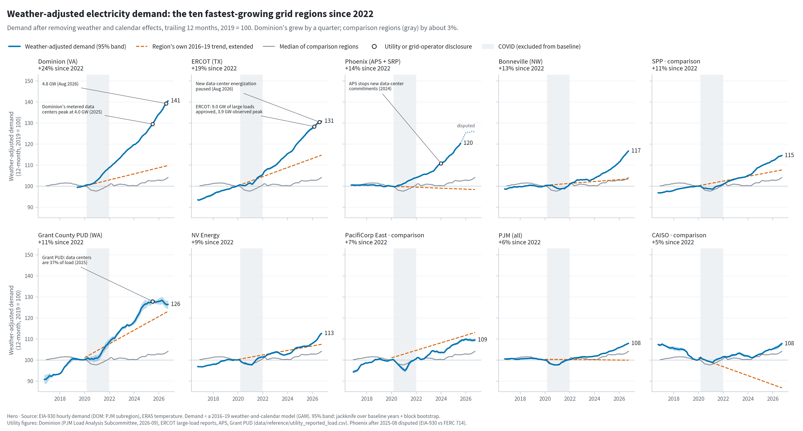

# The Load Nobody Planned For

**Weather-adjusted electricity demand growth across U.S. grids, 2016 to 2026.** Which grid regions show real structural load growth since 2022, does it look like data-center load (a rising 24/7 floor), and is new generation keeping up?

**[Read the report](https://johnpospisil.github.io/datacenter-grid-load/)** · **[Explore any region](https://johnpospisil.github.io/datacenter-grid-load/explorer/)** · Data through **22 October 2026**

[](https://johnpospisil.github.io/datacenter-grid-load/)

## Findings

From calendar 2022 to the 12 months ending October 2026, with the effect of weather and the calendar removed:

1. **Dominion's grid zone in Virginia grew 24%** (18–24% across model specifications), about +3.2 GW of average demand: the most of any region studied. It grew by the same MW at 3 am as at 3 pm, and Dominion's own metered data-center demand accounts for roughly 60–73% of it.
2. **Regions with large data-center build-outs grew 2–10 percentage points faster than comparison regions**, depending on how the regions are grouped and which model is used.
3. **New local generation in Dominion's zone covers about 5% of its new demand.** The rest is met by imports and by existing plants running harder. Texas grew strongly too (11–20%), but the large loads ERCOT tracks peak at about 41% of that growth.

These patterns are *consistent with* data-center load, not proof of it. Crypto mining, semiconductor fabs and population growth matter in some regions; the [report's caveats](https://johnpospisil.github.io/datacenter-grid-load/#caveats) say where.

## How it works

For each of 23 balancing authorities, a generalised additive model learns how hourly demand (EIA-930) responded to population-weighted weather (ERA5) and the calendar in 2016–2019. It has no time trend. It then predicts every hour since; structural growth is actual ÷ predicted. COVID (March 2020 to December 2021) is excluded from every baseline. The headline is re-estimated with LightGBM, a degree-day regression, a shorter baseline, a model fitted on 2022, an employment control and a weather-drift check. It is compared with utility disclosures, EIA-860M generator additions, the LBNL interconnection queue and PJM capacity prices (descriptive only).

Every cleaning rule, mapping decision and known data problem is in [DATA.md](DATA.md). Sources and licences are in [NOTICE.md](NOTICE.md). The pre-publication review is in [report/REVIEW.md](report/REVIEW.md).

## Reproduce

Needs Python 3.12, [Quarto](https://quarto.org) ≥ 1.6, an [EIA API key](https://www.eia.gov/opendata/) and a [Copernicus CDS](https://cds.climate.copernicus.eu) account (key in `~/.cdsapirc`, ERA5 single-levels licence accepted).

```bash
git clone https://github.com/johnpospisil/datacenter-grid-load
cd datacenter-grid-load
python -m venv .venv && source .venv/bin/activate
pip install -e ".[dev]"
cp .env.example .env      # add EIA_API_KEY

make era5                 # ERA5 download, month by month in the background (hours; ~8 GB)
make all                  # data → features → models → figures → explorer → report → tests
```

| Step | Command | Output |
|---|---|---|
| Ingest | `make data` | `data/raw/`, `data/interim/` |
| Clean and build features | `make features` | `data/processed/model_table.parquet` |
| Models and estimates | `make models` | `data/outputs/` |
| Charts | `make figures` | `report/figures/` (PNG + SVG, light and dark) |
| Explorer data | `make explorer` | `app/data/` |
| Report | `make report` | `report/_site/` (report + explorer) |
| Tests | `make test` | pinned headline estimates, data integrity, cleaning rules, DST, figures |

Downloads are cached and idempotent, so re-running is cheap. Headline numbers are pinned in `tests/test_pinned_estimates.py`, so a change in data or method that moves them fails loudly. One input, PJM Data Miner metered load for the Dominion zone, is internal-use only: it was used privately to check the Dominion baseline, is not redistributed, and the pipeline skips it when absent.

## Repository layout

```
src/glg/ingest/   downloaders (EIA-930, ERA5, EIA-860M/861, LBNL queues, prices, ...)
src/glg/build/    cleaning, BA → county weather mapping, features
src/glg/models/   GAM / LightGBM / degree-day baselines, growth, load shape, supply, robustness
src/glg/viz/      chart theme, figures, explorer export, social images
data/reference/   committed, cited reference tables (BA → county map, utility disclosures, ...)
report/           Quarto report (index.qmd), figures, review, social posts
app/              static region explorer (HTML + Observable Plot) and its JSON
tests/            pytest suite
```

## Licence and citation

Code: [MIT](LICENSE). Text, figures and derived tables: [CC BY 4.0](https://creativecommons.org/licenses/by/4.0/), with attribution to the underlying sources as listed in [NOTICE.md](NOTICE.md) (EIA and other U.S. government data are public domain; ERA5, LBNL *Queued Up* and PUDL data carry attribution requirements).

To cite: see [CITATION.cff](CITATION.cff), or

> Pospisil, J. (2026). *The Load Nobody Planned For: Weather-Adjusted Electricity Demand Growth Across U.S. Grids, 2016–2026.* https://github.com/johnpospisil/datacenter-grid-load
